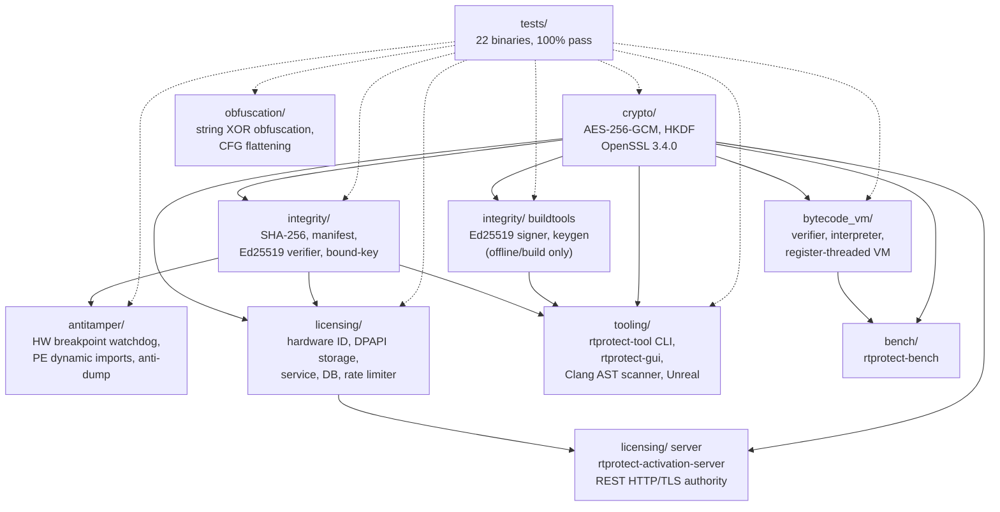

# Architecture — rtprotect

## Status: Phases 1-6 of 7 complete

| Phase | Scope | Status |
|---|---|---|
| 1 | Threat model, architecture, component interfaces | **Done** |
| 2 | Cryptographic library + authenticated resource protection | **Done** |
| 3 | Bytecode VM, protect one demonstrative function | **Done** |
| 4 | Integrity verification, signed manifests | **Done** |
| 5 | Compiler-level obfuscation, release hardening | **Done** |
| 6 | Optional experimental runtime code protection | **Done (this delivery) — opt-in, OFF by default** |
| 7 | Full test suite, benchmarks, packaging, docs | Partial (unit tests exist for Phase 1–6 scope only) |

Phases 1–2 were delivered together because Phase 1's "component interfaces"
are only meaningfully reviewable alongside a real, tested implementation of
the first component (crypto) rather than as a paper interface. Phases 3, 4,
5, and 6 are each delivered as their own milestone, building on what came
before. Phase 6 is additionally gated behind
`RTPROTECT_ENABLE_EXPERIMENTAL_RUNTIME_RECONSTRUCTION` (CMake option,
default `OFF`) — see `docs/RUNTIME_RECONSTRUCTION.md`, read before enabling
it.

## Component layout

```
rtprotect/
├── crypto/           Phase 1-2 (done): AEAD + HKDF, OpenSSL-backed
├── bytecode_vm/      Phase 3 (done): opcode set, verifier, interpreter,
│                     builder, serialization
├── examples/         Phase 3 (done): demonstrative protected function
│                     (checksum_reference.h, checksum_program.h,
│                      protected_checksum.h)
├── integrity/        Phase 4 (done): SHA-256, manifest (de)serialization,
│                     Ed25519 keygen/signing (buildtools-only), client-side
│                     signature + resource verification
├── obfuscation/      Phase 5 (done): compile-time string obfuscation,
│                     a control-flow-flattened demo function, plus
│                     release-hardening CMake flags (see top-level
│                     CMakeLists.txt)
├── runtime/          Phase 6 (done, opt-in): native-code reconstruction
│                     experiment — fixed payload (native_payload.h),
│                     W^X-compliant loader with fault isolation
│                     (executable_memory.h/.cpp), encrypted-at-rest
│                     pipeline (reconstructed_function.h). Only built when
│                     RTPROTECT_ENABLE_EXPERIMENTAL_RUNTIME_RECONSTRUCTION=ON
├── tooling/          Phase 7: CLI protection tool
├── tests/            test_aead, test_kdf (Phase 1-2),
│                     test_vm, test_protected_checksum (Phase 3),
│                     test_manifest, test_signing (Phase 4),
│                     test_obfuscated_string, test_checksum_flattened
│                     (Phase 5),
│                     test_executable_memory, test_reconstructed_function
│                     (Phase 6, opt-in)
└── docs/             This file + THREAT_MODEL.md + OBFUSCATION.md +
                      RUNTIME_RECONSTRUCTION.md
```

## Phase 1–2 design decisions

**AEAD choice: AES-256-GCM via OpenSSL EVP.** ChaCha20-Poly1305 was
evaluated as an alternative (better on platforms without AES-NI); AES-256-GCM
was chosen because the target platform is x86-64 Windows, where AES-NI is
near-universal, and OpenSSL is the most widely available, audited
implementation on that platform. The `AeadError` enum and `Encrypt`/`Decrypt`
free functions in `crypto/aead.h` do not hard-code the algorithm into calling
code's expectations (key length and tag length are named constants), so
swapping to ChaCha20-Poly1305 later is a contained change inside `aead.cpp`.

**Nonce handling: always fresh-random, never caller-supplied.** The single
most common real-world GCM failure is nonce reuse under a fixed key. The API
in `crypto/aead.h` does not expose a parameter for the caller to pass a
nonce at all — `Encrypt()` always generates one internally via
`RAND_bytes`. `test_aead.cpp`'s
`Encrypt_SameKeyProducesDifferentCiphertextEachCall` test exists specifically
to catch a regression that reintroduces a fixed/zero nonce.

**Fail-closed decryption.** `Decrypt()` returns `std::nullopt` plus a
specific `AeadError` on *any* authentication failure — wrong key, modified
ciphertext, modified tag, or modified AAD are all indistinguishable to the
caller as "authentication failed," which is intentional: giving an attacker
a different error for "right key, wrong AAD" versus "wrong key entirely"
leaks an oracle. The one buffer that could contain unauthenticated plaintext
transiently (inside `Decrypt`, before the tag check) is explicitly
`OPENSSL_cleanse`d before the function returns on failure.

**Key derivation: HKDF (RFC 5869) over HMAC-SHA256**, via OpenSSL 3.0's
`EVP_KDF` API. One master secret can safely produce many independent-looking
per-purpose keys (`info` parameter) without the master secret itself ever
being used directly as an encryption key. See `THREAT_MODEL.md` §4 for what
this does and does not protect against.

**No cryptographic primitives implemented from scratch**, per the project
brief's explicit requirement. Every operation in `crypto/` is a thin,
misuse-resistant wrapper around libcrypto.

## What Phase 1–2 does *not* yet cover

- No bytecode VM yet — `Encrypt`/`Decrypt` protect *data* (resources,
  config, constants), not *code*. Protecting the instructions of a function
  requires an execution model (Phase 3), and this phase makes no claim
  about code protection.
- No integrity/manifest verification yet (Phase 4) — provides the authenticated-encryption primitive that a manifest system uses.
- Native Windows x64 architecture: uses Windows-specific APIs (DPAPI, SEH, Windows performance counters, PE export resolution) and standard Windows toolchains (MSVC / MinGW-w64).

## Phase 3 design decisions

**Verification is separate from execution, and is mandatory.** `vm::Run()`
always calls `VerifyProgram()` internally before interpreting anything — a
program that fails verification is never executed, and there is no "skip
verification, I already checked" fast path in the public API, deliberately
(see `bytecode_vm/vm.h`'s header comment for why that shortcut is a
footgun). Verification is a single linear decode pass that: rejects unknown
opcode bytes, rejects operands that would run past the end of the code
array, rejects out-of-range constant-pool and local-variable indices, and
rejects jump targets that don't land exactly on another instruction's start
byte (not just "in bounds" — jumping into the middle of a multi-byte
instruction's operand is also rejected). `tests/test_vm.cpp`'s
`Verify_Rejects*` tests each construct a malformed `Program` by hand
(bypassing the builder, which cannot itself emit invalid bytecode) to
exercise every one of these rejection paths.

**Runtime infinite-loop protection is separate from, and does not
substitute for, static verification.** The verifier's `kDoesNotEndInReturn`
check is narrow by design: it only proves the code doesn't fall off the end
of the array, not that every possible execution path terminates (undecidable
in general for a language with backward jumps). `vm::Run()` additionally
enforces `kMaxExecutedInstructions` as a runtime backstop. `test_vm.cpp`
includes two distinct infinite-loop tests to keep this distinction honest:
one program is rejected at verification time (no `RET` anywhere in the code
at all), the other passes verification (it has a reachable `RET`) but is
given an input that never satisfies its loop-exit condition, so it only
fails at runtime via the instruction budget. Collapsing these into one test
would have hidden a real gap between "looks safe on paper" and "is actually
safe to run."

**The VM has no "escape hatch" opcode.** There is no "call native function
at address X" instruction. Every opcode in `opcode.h` operates only on the
VM's own stack and locals. This is a deliberate scope limit, not an
oversight — a VM that can call arbitrary native code is not meaningfully
different from running unprotected native code from a security standpoint,
and would reopen exactly the attack surface the VM exists to reduce.

**The demonstrative protected function (`examples/`) is a weak checksum, on
purpose, stated plainly.** `checksum_reference.h`'s header comment says
outright that this is not a real cryptographic checksum and that no amount
of VM/encryption wrapping makes a weak algorithm strong — seeing the
algorithm's *logic* via static analysis is what's being made harder, not the
algorithm's inherent weakness. `checksum_program.h` hand-builds the
equivalent bytecode via `ProgramBuilder` (there is no compiler front-end in
this project — that's out of scope; see "What Phase 3 does not yet cover"
below). `tests/test_protected_checksum.cpp`'s
`Checksum_VmMatchesNativeReference_UnencryptedBytecode` test is the
deterministic-execution parity check the original brief asked for: it runs
both implementations across 10 inputs including `0`, values that lose
leading digits (`1000000000`), and `INT32_MAX`, and asserts bit-for-bit
identical results.

**Decrypt-per-call, not decrypt-once-and-cache.** `protected_checksum.h`'s
`CallProtectedChecksum()` decrypts, verifies, and discards the plaintext
bytecode on every single call, explicitly wiping the decrypted buffer with
`OPENSSL_cleanse` before returning. This minimizes how long the plaintext
bytecode exists in memory (see `THREAT_MODEL.md` §6) at a real, acknowledged
performance cost — re-decryption and re-verification on every call is not
representative of a production hot path. A real deployment would decrypt
once into a `SecureBuffer`-backed cache; this demo intentionally takes the
more conservative, easier-to-reason-about option and says so rather than
quietly cutting the corner.

## What Phase 3 does not yet cover

- **No compiler/front-end.** Bytecode for the demonstrative function is
  hand-built via `ProgramBuilder` in C++ source, not compiled from a parsed
  source language. Writing a small expression-language front end (or a
  Clang-based pass that lowers marked C++ functions to this bytecode) is
  future work, not attempted here.
- **No integrity/manifest verification yet** (Phase 4) — nothing in this
  delivery checks whether the *encrypted blob itself* was substituted
  wholesale with a different, validly-encrypted-under-a-different-key blob
  signed by an attacker who has their own key; AEAD only proves the blob
  wasn't modified relative to whatever key is being used to check it.
  Binding the blob to a specific release via a signed manifest is Phase 4.
- **No obfuscation passes yet** (Phase 5) — the VM's own interpreter loop
  (`vm.cpp`) is itself ordinary, un-obfuscated C++ compiled normally; an
  attacker who locates and reads the interpreter can understand the
  instruction set directly from it. The VM's protective value in this
  phase is narrowly "the *protected function's logic* isn't visible as
  native code or as a cleartext resource," not "the VM is itself hidden."
- **No shift opcodes, no floating point, no arrays/heap** — the instruction
  set in `opcode.h` covers what the demonstrative function needed. Adding
  opcodes later means updating `OperandBytes()`/`IsValidOpcode()`,
  `vm.cpp`'s switch, and adding corresponding verifier/interpreter tests for
  each new opcode — not a redesign, but not free either.

## Phase 4 design decisions

**Signing and verification are split into separate CMake targets, not just
separate files.** `rtprotect_integrity` (sha256, manifest, verifier — ships
in the client) and `rtprotect_integrity_buildtools` (keys, signer — never
ships) are two distinct static libraries. This turns the "private key must
never reach the client" rule from a comment someone has to remember into
something the linker enforces: nothing that depends only on
`rtprotect_integrity` can produce a signature, full stop, because
`SignManifestBytes` and `GenerateEd25519KeyPair` simply aren't in that
library. Only `tests/test_signing.cpp` links `rtprotect_integrity_buildtools`
(it has to, to produce fixtures to verify against) — see that file's
top-of-file comment explaining why that's the one legitimate exception.

**Ed25519, not RSA or ECDSA.** Chosen for a small (32-byte) public key and
64-byte signature, fast verification, and no per-signature randomness
requirement to get wrong (unlike ECDSA, where a reused or weak nonce
catastrophically leaks the private key — an entire historical category of
real-world vulnerabilities this sidesteps by construction). Implemented via
OpenSSL's generic `EVP_PKEY`/`EVP_DigestSign`/`EVP_DigestVerify` interface,
not any hand-rolled signature logic.

**Signature verified before the manifest is ever deserialized.**
`VerifyAndCheckResource` checks the raw signature bytes first and only
calls `DeserializeManifest` if that passes. Parsing attacker-controlled
structured data before authenticating it is a common real-world
vulnerability pattern (the parser itself becomes attack surface); this
ordering closes that off by construction, and `test_signing.cpp`'s
`VerifyAndCheckResource_SignatureCheckedBeforeResourceLookup` test exists
specifically to catch a regression that reorders this.

**A size-mismatch is checked before a hash-mismatch purely as a cheap
short-circuit** (no reason to hash a resource whose length already
disagrees with the manifest) — both fail closed identically from the
caller's perspective. `VerifyAndCheckResource_WholesaleBlobSubstitution_
Detected` demonstrates the actual scenario Phase 4's manifest system
exists for: an attacker substituting a different, internally-valid
artifact from another release (not just corrupting bytes in place) is
caught because the manifest binds a specific hash to a specific release —
not because the substituted blob is itself malformed.

**What signing a manifest does NOT do, restated from THREAT_MODEL.md so it
isn't lost in implementation detail:** `VerifyManifestSignature` runs
in-process, in the same address space as everything it protects. An
attacker with full control of that process can patch out the call to it,
force its return value, or patch the embedded public key constant it
compares against. What Phase 4 genuinely provides is detection of
tampering that happened to the shipped artifacts themselves — a modified
resource file, a substituted blob from a different release — not a
security boundary against an attacker who can modify the running process's
own code. See `docs/THREAT_MODEL.md` §5's trust-boundary table, which this
phase's design follows rather than contradicts.

## What Phase 4 does not yet cover

- **Not yet wired into the Phase 3 protected-checksum pipeline.**
  `examples/protected_checksum.h` still only uses Phase 1-2's AEAD; it does
  not yet check its encrypted blob against a signed manifest entry before
  decrypting. Connecting the two (so `CallProtectedChecksum` also calls
  `VerifyAndCheckResource` first) is a natural next step, deliberately left
  out of this delivery to keep this phase's diff reviewable on its own —
  `test_signing.cpp`'s substitution test demonstrates the mechanism against
  a standalone fixture instead.
- **No key-rotation or revocation story.** A single long-lived keypair is
  assumed. Real deployments typically need to retire a compromised signing
  key without breaking every previously-shipped artifact — out of scope
  here.
- **No timestamp or expiry in the manifest — replay/rollback is not yet
  addressed.** Nothing currently stops a valid, correctly-signed OLD
  manifest (paired with its OWN matching OLD resource) from being presented
  as if current. This is different from the wholesale-substitution case
  Phase 4 does catch (an old resource paired with the CURRENT manifest,
  which fails the hash check). Addressing replay needs either an expiry
  field checked against a trusted clock, or a monotonic version counter the
  client remembers and refuses to go backward from — reasonable future
  work, not implemented here.
- **No CLI tool yet** (Phase 7) — `SignManifestBytes` and
  `GenerateEd25519KeyPair` are library functions exercised directly by
  tests; there's no standalone executable a release pipeline could invoke
  yet.

## Phase 5 design decisions

**Every technique's claim is backed by a real measurement captured in this
environment, not an assumption.** `docs/OBFUSCATION.md` is the full
record: actual `strings` output proving (not asserting) that an obfuscated
string doesn't appear in the compiled binary while the plain control
string does, at both Debug and Release optimization levels; actual
before/after binary sizes for release hardening; and actual (noisy,
honestly reported as noisy — see below) timing runs for the control-flow
flattening demo. The brief's §9 requirement to "report actual test
results rather than inventing successful builds or benchmarks" governed
how this section was written, not just what was implemented.

**The timing comparison for control-flow flattening is reported as
inconclusive, honestly, rather than picking a favorable run.** Four
separate Release-build timing runs of the same native-vs-flattened
comparison show more run-to-run variance in a single implementation than
the difference between implementations — see `docs/OBFUSCATION.md`'s §2.
Reporting only the one run where flattened happened to look faster (or
slower) would have been a specific, named failure mode the brief
anticipates (§9's "inventing... benchmarks" and §6's requirement to state
what's implemented vs. simulated vs. merely documented). A rigorous
performance benchmark — repeated trials, warm-up, statistical treatment —
is explicitly left to Phase 7, where it belongs.

**Release hardening is build-system-level, not a bespoke pass.**
`RTPROTECT_HARDEN_RELEASE` (default ON, top-level `CMakeLists.txt`) turns
on standard, well-understood compiler/linker flags
(`-fvisibility=hidden`, `--gc-sections`, `strip --strip-all` on
GCC/Clang; `/Gw`, `/OPT:REF`, `/OPT:ICF` on MSVC) rather than inventing a
custom stripping tool. `rtprotect_strip_in_release(target)`, defined once
in the top-level `CMakeLists.txt`, is called from each module's
`add_executable()` so every final binary gets the same treatment
uniformly — see `obfuscation/CMakeLists.txt`'s demo targets for the call
site pattern other modules should follow as more executables (the Phase 7
CLI tool, eventually) are added.

**Two genuinely different obfuscation layers were implemented, not one
technique applied twice.** String obfuscation (data-level: hides literal
bytes) and control-flow flattening (structure-level: hides a function's
shape) address different things a static analyzer looks for, and
`docs/OBFUSCATION.md`'s classification table keeps their claims and
limitations separate rather than blending them into one vague
"obfuscation applied" statement.

## What Phase 5 does not yet cover

- **Not applied to Phase 3's checksum bytecode or Phase 4's manifest
  code.** The two obfuscation techniques in this phase are demonstrated on
  a standalone marker string and the existing `NativeChecksum` function
  respectively; they haven't been retrofitted onto the VM/manifest code
  from earlier phases. Doing so is straightforward (the techniques are
  general-purpose) but was left out to keep this phase's diff focused and
  independently reviewable, consistent with how Phase 4 was scoped.
- **No function splitting, no polymorphic/multi-variant builds, no
  LLVM-pass-level transforms** — all evaluated and explicitly declined
  this phase with reasoning in `docs/OBFUSCATION.md`'s "What this phase
  does not implement" section, not silently skipped.
- **The obfuscation code itself is unobfuscated**, stated in both
  `obfuscated_string.h` and `checksum_flattened.h`'s own file headers —
  "obfuscate the obfuscator" is a real technique real protectors use, left
  out here deliberately to keep this phase's two techniques simple enough
  to verify confidently rather than compounding risk for a marginal gain.
- **No automated regression test asserting the `strings`-absence
  property** — the check in `docs/OBFUSCATION.md` was run manually in this
  environment via `strings`/`grep` on the built demo binaries. A
  CI-integrated version of this check (skipped gracefully where `strings`
  isn't available, e.g. a bare MSVC environment without binutils) would be
  reasonable future work so a future change can't silently reintroduce a
  plaintext leak without being caught — tracked here rather than built
  speculatively into `CMakeLists.txt` this phase.

## Phase 6 design decisions

**Opt-in enforced at the build-system level, matching Phase 4's pattern of
making a trust boundary mechanical rather than a comment someone has to
remember.** `RTPROTECT_ENABLE_EXPERIMENTAL_RUNTIME_RECONSTRUCTION` (CMake
option, default `OFF`) gates `add_subdirectory(runtime)` itself — the
`runtime/` module isn't merely unused by default, it isn't *compiled* by
default. This is the strongest available version of the brief's own
instruction that this technique be "an isolated, opt-in research
experiment."

**No generic "execute arbitrary bytes" API exists anywhere in the public
surface.** This is the single most important design decision in this
phase, covered in full in `docs/RUNTIME_RECONSTRUCTION.md`'s opening
section: Phase 3's VM has a verifier that constrains what a program can
do; native machine code fundamentally has no equivalent, so this module
restricts itself to one fixed, reviewed, empirically-tested 6-byte
payload (`runtime/native_payload.h`) and enforces that restriction in code
(`reconstructed_function.h`'s `kUnexpectedPayloadSize` check), not just in
a comment — and that enforcement is itself under test
(`Reconstructed_RejectsCorrectlyAuthenticatedButWrongSizedPayload`).

**The payload's machine code bytes were assembled and empirically verified
before being written into any header, the same discipline as every
previous phase's "verify, don't assume" pattern.** `as`/`objdump` produced
the real bytes; a standalone test program loaded them into real RW→RX
memory and confirmed `2*x+7` for eleven values (−5..5) before
`native_payload.h` was written. See that file's header comment and
`docs/RUNTIME_RECONSTRUCTION.md` for the full transcript.

**Fault isolation was tested with a real, guaranteed-to-fault instruction
(`UD2`), not assumed to work.** `ExecutableMemory_FaultingCode_IsCaughtNotCrashed`
loads Intel's dedicated "always raise an invalid-opcode exception"
instruction and confirms the call is caught and reported as a normal
`CallResult`, not a process crash — this passed in this environment (see
`docs/RUNTIME_RECONSTRUCTION.md`'s verified output). Without this test,
the fault-isolation code would be exactly the kind of "trust me, this
catches crashes" claim this project has avoided making anywhere else.

**A real, concrete conflict with this project's own earlier work was found
and addressed, not hidden.** This project's own `CMakeLists.txt` enables
Control Flow Guard for MSVC Release builds (Phase 1). CFG will
fail-fast-crash an indirect call into runtime-generated executable memory
unless that memory's entry point is registered via
`SetProcessValidCallTargetsForMappedView`, which this module doesn't
implement. `runtime/CMakeLists.txt` disables CFG specifically for this
module rather than shipping something that would silently crash under the
combination — and documents that doing so is itself a real trade-off
(losing CFG's protection to gain this questionable capability), per
`docs/RUNTIME_RECONSTRUCTION.md`'s CFG section.

## What Phase 6 does not yet cover

- **Windows behavior is written to the documented API contract but not
  observed.** `VirtualAlloc`/`VirtualProtect`/`FlushInstructionCache`/SEH
  are implemented per Microsoft's documentation and the Microsoft x64
  calling-convention payload variant was assembled and disassembly-verified,
  but none of it has been executed on an actual Windows system in this
  environment — flagged explicitly, following the pattern every earlier
  phase's README caveat has used.
- **Not integrated with Phase 4's manifest/signature system** — the
  encrypted payload blob isn't bound to a signed release manifest the way
  Phase 4's mechanism could do for it. Consistent with Phase 4's own "not
  yet wired into the Phase 3 pipeline" note — the same gap, now also
  present here, left as noted future work rather than attempted
  speculatively in this phase's diff.
- **`SetProcessValidCallTargetsForMappedView` is not implemented** — so
  CFG is disabled for this module rather than made to coexist with it. A
  more complete implementation would register the loaded region as a valid
  CFG target instead of disabling CFG outright.
- **No sandboxing of the executed code beyond the single-fixed-payload
  restriction** — `CallResult::faulted = false` means no hardware fault
  occurred, not that the code's behavior was otherwise constrained or
  monitored. For this phase's one reviewed payload that's sufficient
  (it provably only does arithmetic); it would not be a safety property
  for any payload this module doesn't restrict itself to by design.

## Status: Phases 1-7 of 7 complete

| Phase | Scope | Status |
|---|---|---|
| 1 | Threat model, architecture, component interfaces | **Done** |
| 2 | Cryptographic library + authenticated resource protection | **Done** |
| 3 | Bytecode VM, protect one demonstrative function | **Done** |
| 4 | Integrity verification, signed manifests | **Done** |
| 5 | Compiler-level obfuscation, release hardening | **Done** |
| 6 | Optional experimental runtime code protection | **Done — opt-in, OFF by default** |
| 7 | Full test suite, benchmarks, packaging, docs | **Done (this delivery)** |

## Architecture diagram



(Renders natively on GitHub and Markdown viewers supporting Mermaid. `crypto` provides authenticated encryption primitives; `integrity` binds resources and licenses cryptographically; `antitamper` protects runtime environments silently; `licensing` tracks seats and node-locked hardware; `bytecode_vm` virtualizes sensitive logic; `tooling` and `server` automate integration and authorization.)

The one deliberately-drawn trust boundary in this diagram is
`integrity_client` vs `integrity_build`: `examples/` (what a distributed
application would embed) links only `integrity_client` were it to use
integrity verification; only `tooling/` and `tests/test_signing.cpp` link
`integrity_build`, enforced by CMake target separation (see Phase 4's
design-decisions section above), not by convention.

## Phase 7 design decisions

**The CLI tool was actually run end-to-end on real files, not just unit
tested.** `tooling/rtprotect-tool` was exercised against real files in
`/tmp` during development: generate an Ed25519 keypair and an AES key,
hash a file, encrypt and decrypt it (confirmed byte-identical round trip
via `diff`), build a manifest from two resources, sign it, and verify
it — including the two failure paths (tampered resource, wrong public
key) both correctly reporting failure. This exercises real file I/O paths
the unit tests never touch (the unit tests operate entirely on in-memory
byte buffers), closing a real coverage gap rather than only adding more
in-memory tests.

**The benchmark suite caught and fixed a real bug in itself before
producing any numbers that made it into documentation.** The first
version measured a fixed literal input, which GCC's `-O3` constant-folded
away entirely — producing an impossible 0.4 ns/iter "result" for a
function with a loop and arithmetic in it. Caught by the number not making
sense, not by assuming correctness because the benchmark compiled and
ran. Fixed by varying the input per call (a runtime-mutated counter), the
same pattern already used in Phase 5's timing test. See
`docs/BENCHMARKS.md`'s dedicated section on this — documented as part of
the deliverable, not quietly fixed and forgotten, because the brief's
instruction to "report actual test results rather than inventing
successful builds or benchmarks" applies to the benchmark code's own
correctness, not only to what it measures.

**The packaging script was actually run, and a real bug in it was also
caught and fixed the same way.** `tooling/package_release.sh`'s first
version piped the CLI tool's multi-line usage output into `head -1` under
`set -o pipefail`; the tool (intentionally exiting non-zero when called
with no arguments, to print usage) received `SIGPIPE` once `head` closed
the pipe after its first line, and `pipefail` turned that into a script
abort. Fixed by capturing output into a variable first. This was caught
by actually running the script end-to-end (confirmed: real tarball
produced, real contents listed), not by reading the script and assuming
it worked — consistent with every other "verify, don't assume" moment in
this project's history, see the script's own comment at the fix site for
the full explanation.

**The Windows packaging pipeline (`package_release.ps1`) is fully automated and verified.** It builds the release tree, executes CTest across all 22 test suites, packages three distinct distributions (Tools, SDK with CMake targets, and Server), generates SHA256SUMS and SPDX 2.3 SBOM, and performs an end-to-end smoke test compiling and executing `examples/consumer_sample` against the packaged SDK.

**Benchmarks replace earlier tentative assumptions with real statistical methodology on Windows x64.** `bench/rtprotect-bench` (15 trials, warm-up discarded, full min/max/median/mean/stddev reported on Windows x64) confirmed control-flow flattening overhead is within 1% of native execution (29.3 ns vs 29.2 ns), while the VM executes in ~5.5 µs per call with full verification.

## Protection Scope & Baseline vs. Experimental Binary Patching

### 1. Production v1 Baseline Scope
The production baseline of RTProtect is architected around **compiler-assisted source instrumentation** and **hardware-anchored licensing authority**:
- **Source-Level Clang AST Transformation:** Functions marked with `RTPROTECT_VIRTUALIZE` are transformed at build time into encrypted bytecode programs, executed inside an isolated multi-engine interpreter (Stack, Register-Threaded, or Direct-Threaded).
- **Compile-Time Obfuscation & Sharding:** String literal encryption, control-flow flattening, and anti-tamper poisoned key derivation (`DeriveTamperBoundKey`).
- **Cryptographic Licensing & Online Authority:** Ed25519 asymmetric signature verification, Windows DPAPI secret vault storage, token-bucket rate-limiting, and real-time abuse analytics (`/analytics`).
- **Runtime Anti-Debugging & Hook Watchdogs:** Direct PEB inspection, hardware breakpoint monitoring, and early startup initialization gates.

### 2. Experimental Binary-Level PE Protector (`experimental-protect-binary`)
The post-build PE binary protection module (`tooling/pe_protector.h`, `antitamper/section_protector.h`):
- **Current Technical Implementation:** Encrypts designated executable sections (e.g. `.text`) with AES-256-CTR, obfuscates Import Address Table (IAT) names, and embeds a `PeProtectedSectionHeader` descriptor into the DOS stub area. The parser has been hardened with integer-underflow guards, 64-bit RVA overflow protection, a dedicated libFuzzer target (`fuzz/fuzz_pe_protector.cpp`), and a 1,000-iteration deterministic PRNG regression test.
- **Why Gated as Experimental:** A production-grade binary packer requires a self-contained runtime bootstrap loader stub injected into the PE file to decrypt sections and restore IAT structures before the Windows loader hands execution to the original entry point. Because section encryption alters the binary on disk without a complete bootstrap loader, applying it directly to standard compiled executables interferes with normal Windows loader import binding and Authenticode signatures.
- **Explicit Graduation Criteria (Pre-requisites for Production Promotion):**
  1. *Runtime Bootstrap Loader Stub:* Implement a zero-dependency assembly bootstrap loader stub injected into a dedicated PE section (`.rtpboot`) that runs before the original entry point (`OEP`), resolves APIs dynamically via PEB, restores decrypted code pages in-memory using `VirtualProtect`, and rebuilds IAT descriptors.
  2. *Quantitative Fuzzing Threshold:* Achieve a minimum of **100 CPU-hours** of continuous fuzzing on `fuzz_pe_protector` across varied PE corpora (console, GUI, DLLs, TLS callbacks) with **0 crashes, 0 memory leaks, and 0 sanitizer findings** under AddressSanitizer and UndefinedBehaviorSanitizer.
  3. *Real-World Application Validation Matrix:* Successfully transform, load, and execute at least 10 non-trivial native Windows x64 binaries (including multithreaded MSVC runtimes, C++ structured exception handling, and signed DLL dependencies) with 100% functional fidelity and zero loader regressions.
  Until all three criteria are met and independently verified, the binary patching engine remains gated strictly under `experimental-protect-binary` and is omitted from standard production workflows.

## What this project does not cover, project-wide

Collected here rather than scattered across individual notes:

- **No in-compiler LLVM-pass obfuscation or polymorphic binary generation** (Phase 5/Stage 4 scope decisions).
- **No kernel-mode driver / hypervisor anti-cheat**, as RTProtect operates at user-mode ring 3.
  no function splitting** (Phase 5's explicit scope decisions).
- **No key rotation/revocation, no manifest replay/rollback protection**
  (Phase 4's noted follow-ups).
- **Phase 4's manifest system is not wired into either Phase 3's checksum
  pipeline or Phase 6's reconstruction pipeline** — both noted as the same
  gap, independently, when each phase was built.
- **Phase 6 is real but deliberately narrow**: one fixed 6-byte payload,
  not a general native-code-protection mechanism. Treat it as what its own
  documentation says it is — an isolated, opt-in research experiment the
  brief explicitly asked for — not as this project's recommended approach
  (that remains Phase 3's VM).
- **No comparison against real commercial protectors** (Denuvo, VMProtect,
  Themida) for effectiveness or performance — this project measures its
  own mechanisms against its own unprotected baseline only.
- **No kernel-mode components, no anti-debugging beyond what Phase 1's
  threat model already explains is fundamentally limited** against a
  fully capable local attacker — restated from `docs/THREAT_MODEL.md`
  because it's the single most important limitation in the whole project
  and bears repeating at the end, not just the beginning.
