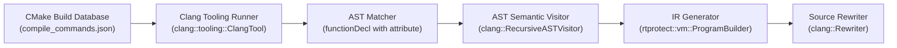

# RTProtect Client Project Integration Guide

## 1. Overview and Core Philosophy

RTProtect is a commercial-grade software protection, anti-tampering, and cryptographic licensing framework designed for C and C++ applications. Its primary goal is to significantly raise the cost, time, and tooling complexity required for unauthorized modification, license forgery, binary patching, and reverse engineering.

RTProtect is structured around **defense-in-depth**:
- **Asymmetric Cryptography:** All authorization decisions rely on vendor-signed Ed25519 certificates. Private keys reside strictly on offline vendor build systems or licensing backends; distributed client binaries contain only public verification keys.
- **Fail-Closed Verification:** Missing signatures, malformed payloads, hardware mismatches, or detected debuggers result in immediate rejection or policy enforcement.
- **Transactional Integration:** The `rtprotect-tool` executable safely plans, dry-runs, backups, instruments, and verifies client software projects without destructive side-effects.

---

## 2. Prerequisites & Environment

Before integrating RTProtect into a client application, ensure your development or build-pipeline environment meets the following baseline requirements:

| Component | Minimum Version | Recommended Version |
|---|---|---|
| Operating System | Windows 10 (x64) / Windows Server 2019+ | Windows 11 (x64) 23H2+ |
| C++ Compiler | C++20 compliant (GCC 12+, MSVC 19.30+, Clang 15+) | MinGW-w64 GCC 15.2+ or MSVC 2022 v17.9+ |
| Build System | CMake 3.20+ with Ninja or MSBuild | CMake 3.28+ with Ninja generator |
| Cryptography | OpenSSL 3.0+ (EVP API supported) | OpenSSL 3.4.0+ (bundled in `third_party/openssl/`) |

---

## 3. Integration Workflow

Integration follows a 4-step transactional process:

```
[Target Project]
       │
       ▼
 1. Dry-Run & Inspection (rtprotect-tool integrate <path> --dry-run)
       │
       ▼
 2. Transactional Backup (.rtprotect_backup_<timestamp>/)
       │
       ▼
 3. Instrumentation & Code Generation
    ├─ rtprotect_config.h        (Public key, product ID, security profile)
    ├─ rtprotect_runtime_glue.cpp (Integrity, license, and anti-tamper logic)
    ├─ client.license            (Hardware-bound Ed25519 signed license)
    ├─ release.manifest          (SHA-256 build resource manifest)
    ├─ release.sig               (Ed25519 digital signature of manifest)
    └─ CMakeLists.txt            (Modified with hardening compiler flags & links)
       │
       ▼
 4. Validation & Verification (rtprotect-tool validate-build <path> ...)
```

---

## 4. Integration Tool CLI Commands

The `rtprotect-tool` executable provides complete command-line automation for build and release pipelines:

### 4.1 Previewing Changes (`--dry-run`)
Always perform a dry-run preview before modifying files on disk:
```powershell
rtprotect-tool.exe integrate path/to/client_app --dry-run --report dry_run.json
```
This inspects the project, identifies source files and build scripts, prints a structured change summary, and emits an optional JSON report without touching any existing files.

### 4.2 Executing Integration
To apply protection to a project:
```powershell
rtprotect-tool.exe integrate path/to/client_app `
    --profile balanced `
    --product com.vendor.clientapp `
    --version 1.0.0 `
    --rtprotect-root "C:\path\to\rtprotect" `
    --no-build
```

#### Available CLI Options:
- `--profile <dev|balanced|maximum>`: Selects security policy and compiler hardening flags (see §5).
- `--dry-run`: Runs inspection and displays change plan without disk modifications.
- `--dev-keys`: Uses deterministic test keys for offline unit tests.
- `--backup-dir <dir>`: Specifies custom directory for project backup (default: timestamped folder inside project).
- `--report <json>`: Emits machine-readable execution report in JSON format.
- `--product <id>`: Canonical product identifier (e.g. `com.enterprise.crm`).
- `--version <ver>`: Release version string (e.g. `2.4.1`).
- `--rtprotect-root <dir>`: Base path to RTProtect framework distribution.
- `--no-build`: Skips automatic compilation after integration.
- `--non-interactive`: Bypasses any interactive confirmations in CI/CD pipelines.

### 4.3 Rolling Back an Integration
If an integration needs to be revoked or reverted:
```powershell
rtprotect-tool.exe rollback path/to/client_app path/to/backup_dir
```
The rollback command:
1. Restores all backed-up files (`CMakeLists.txt`, headers) to their exact byte-for-byte state.
2. Removes all generated RTProtect artifacts (`rtprotect_config.h`, `rtprotect_runtime_glue.cpp`, `client.license`, `release.*`).
3. Validates against path traversal vulnerabilities to prevent unauthorized directory escapes.

### 4.4 Validating Build Outputs
To verify that shipped binaries and resource files match the vendor-signed release manifest:
```powershell
rtprotect-tool.exe validate-build path/to/client_app release.pub release.manifest release.sig
```

---

## 5. Protection Profiles

RTProtect supports three tiered protection profiles:

| Feature / Hardening | `development` | `balanced` (Default) | `maximum` |
|---|---|---|---|
| **Anti-Debug Policy** | Report only (logs warnings) | Restrict high-risk capabilities | Terminate process immediately |
| **Hypervisor Detection** | Disabled | Evaluated in risk score | Enforced (terminates execution) |
| **Hardware Binding Score** | 0.50 (Permissive) | 0.75 (Recommended) | 0.90 (Strict) |
| **Compiler Hardening (GCC)** | Standard | `-fstack-protector` | `-fstack-protector-strong -fPIE -pie` |
| **Compiler Hardening (MSVC)** | Standard | `/GS /DYNAMICBASE` | `/guard:cf /DYNAMICBASE /NXCOMPAT /GS` |
| **Clock Rollback Tolerance** | 24 Hours | 5 Minutes | Strict Monotonic (0 Tolerance) |

---

## 6. Client Code Integration Walkthrough

After running `rtprotect-tool integrate`, the target project receives `rtprotect_config.h` and `rtprotect_runtime_glue.cpp`. Include `rtprotect_config.h` at application startup:

```cpp
#include <iostream>
#include "rtprotect_config.h"

int main() {
    // Execute runtime risk assessment, manifest integrity, and license verification
    if (!rtprotect_client::VerifyClientIntegrityAndLicense()) {
        std::cerr << "Fatal: Security check failed. Application unauthorized or tampered with.\n";
        return 1;
    }

    std::cout << "Integrity verified. Product: " << rtprotect_client::kProductId << "\n";
    
    // Core application execution continues safely
    RunApplicationLogic();
    return 0;
}
```

---

## 7. Troubleshooting & FAQs

### Q: Why does the integrated binary fail to find `libcrypto-3-x64.dll` at runtime?
**A:** Ensure `third_party/openssl/bin` is added to the system `PATH` or copy `libcrypto-3-x64.dll` alongside the target executable.

### Q: Can an attacker patch out `VerifyClientIntegrityAndLicense()`?
**A:** In a client-controlled environment, any single check can theoretically be located and bypassed by an advanced reverse engineer with sufficient time. To mitigate this:
1. Enable `maximum` profile with Control Flow Guard (`/guard:cf`) and PIE.
2. Intersperse calls to `antitamper::AssessEnvironmentRisk()` throughout background worker threads.
3. Use VM opcode virtualization (`bytecode_vm/`) for critical proprietary algorithms.
4. Utilize `licensing::VerifyLicenseBytes` directly inside business calculations.

### Q: How do I manage customer licenses for different tiers (e.g. Standard vs Enterprise)?
**A:** Use `rtprotect-tool license-generate` on your secure vendor server:
```powershell
rtprotect-tool.exe license-generate `
    --priv-key vendor.priv `
    --out enterprise.license `
    --product com.vendor.clientapp `
    --edition Enterprise `
    --capabilities core,adv,commercial `
    --expires-in-days 365
```
Deliver `enterprise.license` to the client. The client binary verifies the edition and capabilities against the vendor's embedded public key.

---

## 8. Function Virtualization & Clang LibTooling Migration Roadmap

### 8.1 Current Automated Virtualization Architecture
RTProtect includes an integrated C-subset compiler (`bytecode_vm/compiler.h`) and source transformation pipeline (`tooling/integration_engine.cpp`) that automatically converts annotated functions into encrypted VM bytecode:

1. **Tagging:** Functions marked with `RTPROTECT_VIRTUALIZE` (or `int fn(params) /* RTPROTECT_VIRTUALIZE */`) are extracted during the `integrate` workflow.
2. **Lexical State Machine:** Source scanning uses a comment- and string-aware state machine to accurately extract function signatures and bodies without being fooled by braces `{}` inside string literals or comments.
3. **Bytecode Compilation:** The body is parsed by a recursive-descent compiler supporting arithmetic, bitwise operators, local variables, conditional branching (`if/else`), iterative loops (`while`), subroutines (`call/ret`), and direct memory indexing (`load8`, `store8`, `load64`, `store64`).
4. **Opcode Permutation:** Bytecode instructions are emitted using per-build randomized opcode maps (`OpcodeMap::FromSeed(kBuildOpcodeSeed)`), rendering universal bytecode decompilers ineffective across different builds.
5. **Tamper-Bound Encryption:** The compiled bytecode is encrypted with AES-256-GCM using keys derived from HKDF-HMAC-SHA256 (`DeriveTamperBoundKey`). If debuggers, hooks, or timing anomalies are detected, the derived key is poisoned, producing silent execution failure.
6. **Master Key Protection:** Sharded compile-time XOR secrets (`kAuthShard0..3 ^ kAuthMask0..3`) and per-function salts ensure zero plaintext master keys reside in `.rodata`.

### 8.2 Migration Path to Clang LibTooling for Enterprise Deployments
For large enterprise codebases with extensive C++20 features, complex macro expansions, templates, and classes, RTProtect provides an architectural roadmap to migrate from the current source-level regex/lexical extractor to a dedicated Clang LibTooling frontend:



#### Step 1: Compilation Database Integration
Enterprise builds generate `compile_commands.json` by adding `set(CMAKE_EXPORT_COMPILE_COMMANDS ON)` in CMake. The Clang tool consumes this database to parse translation units with exact include paths, preprocessor definitions, and compiler flags identical to the production build.

#### Step 2: C++ AST Matchers
Replace regex markers with standard C++ attributes or annotations:
```cpp
[[clang::annotate("rtprotect_virtualize")]]
int CalculateSecretAlgorithm(int a, int b) { ... }
```
A Clang AST Matcher locates targeted declarations reliably across complex header inclusion hierarchies:
```cpp
auto matcher = functionDecl(hasAttr(attr::AnnotateAttr), hasName("rtprotect_virtualize")).bind("virt_fn");
```

#### Step 3: Semantic AST Lowering to VM IR
Rather than compiling from text, a custom `clang::RecursiveASTVisitor` traverses the resolved Clang `Stmt` and `Expr` AST nodes:
- `BinaryOperator` (`+`, `-`, `*`, `/`, `^`, `&`, `|`) maps directly to `ProgramBuilder::EmitAdd()`, `EmitSub()`, etc.
- `DeclRefExpr` and `VarDecl` resolve typed stack offsets without variable name collisions.
- `IfStmt` and `WhileStmt` translate control flow into label jumps (`EmitJz`, `EmitJmp`) with guaranteed type checking and constant propagation.
- Pointer dereferences (`*ptr`, `ptr[idx]`) map directly to `EmitLoadMem8` / `EmitStoreMem64` with compiler-verified bounds checks.

#### Step 4: Automated Code Replacement via `clang::Rewriter`
`clang::Rewriter` replaces the original function body with the encrypted bytecode blob and client VM runner (`rtprotect::vm::Run`), leaving outer function prototypes, calling conventions, and ABI linkages completely intact.

