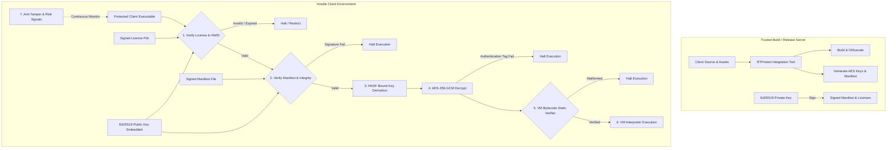

# RTProtect Comprehensive Threat Model & Security Posture

**Document Version:** 2.0.0  
**Target Systems:** Windows 10/11 x64 (Primary), Linux x86-64 (Cross-platform Core)  
**Security Reference:** Commercial Protection Architectures (Denuvo-style Layered Defense-in-Depth)  

---

## 1. Role and Principles

RTProtect is an engineering-grade software-protection, license verification, and anti-tampering framework designed to integrate defenses into authorized client software through a dedicated command-line and build tool.

The design is governed by foundational engineering realities:
1. **Person-at-the-End (PATE) Model:** An adversary with administrative control of their machine, a debugger, and physical possession of binary artifacts can eventually inspect or modify client-side execution.
2. **Cryptographic Security vs. Obfuscation:** Cryptographic primitives (signatures, authenticated encryption) guarantee authenticity, integrity, and confidentiality when keys are protected. Obfuscation (flattening, string hiding, VM interpretation) increases the work factor and economic cost of analysis; it is never a substitute for cryptographic verification.
3. **Defense-in-Depth:** No single check is permanent. Resilience arises from intermeshed, layered defenses: asymmetric licensing, committed hash key-derivation, static and runtime VM bytecode verification, anti-tamper risk signals, and signed build manifests.

---

## 2. Attacker Capabilities & Mitigations Matrix

| Attacker Capability | Attacker Tools & Techniques | Mitigating Defenses | Defenses that Increase Attacker Cost | Residual Risk |
|---|---|---|---|---|
| **1. Casual Copying & License Sharing** | Copying application folder to unauthorized machines; sharing license keys or credentials across users. | Hardware-bound licensing (`licensing/hardware_id.h`) binding license tokens to unique, weighted machine fingerprints; Ed25519 digital signature verification. | Obfuscated license parsing, encrypted license payload at rest. | Low. Machine fingerprint emulation inside virtualized containers or customized hypervisors. |
| **2. Static Analysis & Binary Patching** | IDA Pro, Ghidra, binary hex editing, NOPing conditional jumps (`jz/jnz`), modifying string literals or crypto constants. | Bound Key Derivation (`integrity/bound_key.h`): decryption key derived from committed manifest hash via HKDF. Tampering results in bad key and AEAD authentication failure. | Control-flow flattening (`obfuscation/checksum_flattened.h`), compile-time string encryption (`obfuscated_string.h`), Bytecode VM interpretation (`bytecode_vm/`). | Medium. Attacker with decompilation tools can analyze the interpreter dispatch loop and reconstruct algorithm semantics. |
| **3. Dynamic Analysis & Runtime Instrumentation** | WinDbg, x64dbg, GDB, Frida, API Monitor, memory dumping (Process Hacker). | Runtime risk signals (`runtime/anti_tamper.h`): `IsDebuggerPresent`, `CheckRemoteDebuggerPresent`, DR0-DR3 hardware breakpoint detection, timer discrepancy detection (`RDTSC`/`QPC`). Sensitive buffer wiping (`crypto/secure_buffer.h`). | Dynamic opcode permutation (`opcode_map.h`), non-linear execution flow, W^X protected memory regions. | High. A skilled analyst with kernel-level driver or hypervisor can bypass user-mode debugger detection and dump decrypted memory. |
| **4. Automated Reverse Engineering & Scripted Tampering** | Automated unpackers, generic signature-based bypass scripts, replay tools. | Manifest signature verification, monotonic sequence validation, strict input validation and bounds checking. | Build-seeded VM opcode tables, diversified instruction encodings, control-flow obfuscation. | Low. Automated generic tools fail; attacker must invest substantial manual reverse-engineering effort. |
| **5. Advanced Attackers with Administrator / Hypervisor Access** | Hypervisor-based debuggers (ScyllaHide, custom KVM/Xen), hooked system calls, manipulated system clocks, memory patching via kernel driver. | Multi-point integrity verification, monotonic counter verification (TPM / backend attestation), client-side clock rollback tolerance detection. | Bytecode virtualization with closed instruction set, integrity-bound key derivations. | High. Purely client-side defenses cannot permanently prevent defeat by a ring-0 adversary. Protection raises cost/time to make commercial piracy economically unviable. |
| **6. Compromise of Build Infrastructure or Licensing Backend** | Leaked private signing keys, altered build artifacts, rogue key generation. | Strict separation of buildtools (`rtprotect_integrity_buildtools`) and signing keys. Client binaries contain **only public verification keys**. Ephemeral dev/test keys separated from production. | Signed release manifests, build provenance auditing, reproducible build manifests. | Low for client binaries; server-side HSM/KMS key management is required for signing infrastructure. |

---

## 3. Trust Boundaries and Security Invariants

### 3.1 Trust Boundaries
1. **Server / Build Environment (Fully Trusted):** Holds the Ed25519 private signing keys for manifests and licenses. Generates master keys and signs releases. Private keys **never** leave this boundary.
2. **Client Binary & Local Operating System (Hostile / Untrusted):** The client application runs under the control of the user. Only public verification keys (`Ed25519PublicKey`) and encrypted resources are distributed.
3. **Protected Runtime Core (Hardened Boundary):** Operates within the client process. Enforces authenticated decryption, verified VM bytecode interpretation, and integrity monitoring. All operations fail closed upon authentication or verification failure.

### 3.2 Non-Negotiable Security Invariants
- **No Embedded Private Keys:** A client distribution shall never contain server private keys, master license generation secrets, or backdoor passwords.
- **Fail-Closed Authorization:** Any verification failure (tampered ciphertext, invalid signature, expired license, corrupted manifest, mismatched hardware fingerprint) causes immediate termination or restricted operation.
- **Cryptographic Independence:** Trust is anchored in Ed25519 public keys, not plain checksums or easily patched local variables.
- **Zero Raw Nonce Reuse:** AES-256-GCM nonces are 96-bit cryptographically secure random values generated exclusively inside `crypto::Encrypt` via OS CSPRNG.
- **Volatile Plaintext Lifecycle:** Plaintext secrets in memory are wrapped in `SecureBuffer` and scrubbed via `OPENSSL_cleanse` before deallocation.

---

## 4. Layered Defense Architecture

---

## 5. Residual Risk Acceptance

1. **Memory Scraping During Live Execution:** Because decrypted code or data must momentarily exist in memory to be processed by CPU registers, an attacker attaching a hardware debugger at the exact instruction of execution can view plaintext.
   - *Mitigation:* Bytecode interpretation eliminates native function disassembly; VM executes memory-bound bytecode step-by-step; `SecureBuffer` clears memory on scope exit.
2. **Hypervisor Emulation & Spoofing:** A custom hypervisor can spoof CPUID values, MAC addresses, and disk serial numbers to defeat hardware binding.
   - *Mitigation:* Multi-metric weighted fingerprinting (combining volume GUID, computer name, CPU brand/features, BIOS UUID) requires coordinated spoofing across multiple subsystem interfaces.
3. **In-Process Patching by Kernel Administrator:** A local administrator with a signed driver can patch code bytes directly in physical RAM.
   - *Mitigation:* Periodic code-section integrity hashing, bound key derivation, and signed manifest verification ensure that any modified section invalidates subsequent operations.
