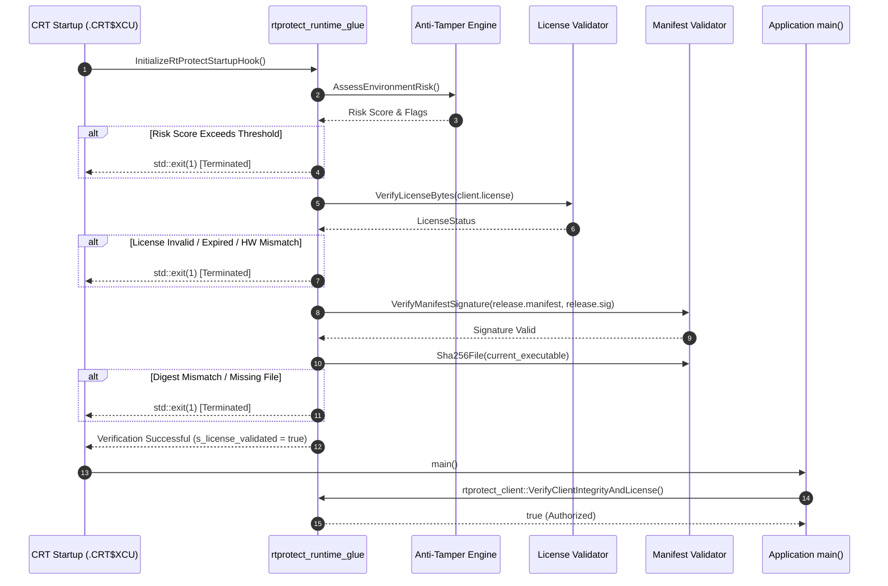
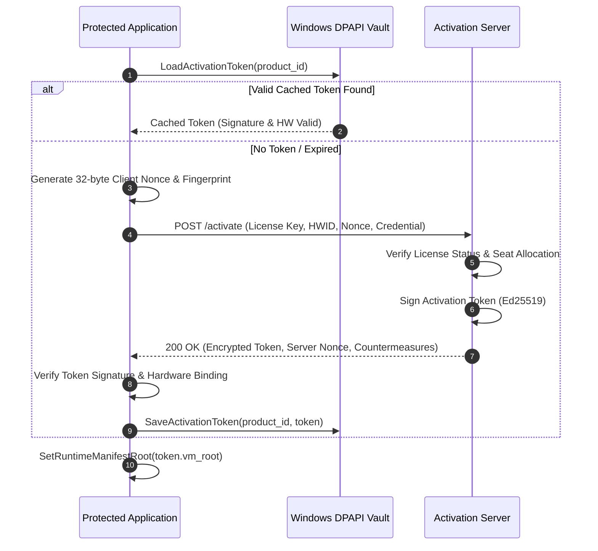

# System Architecture

## 1. Architectural Scope and Purpose

RTProtect is an enterprise-grade binary protection and cryptographic licensing framework designed for native C and C++ applications running on Windows x64. The system protects proprietary intellectual property, prevents unauthorized binary modification or tampering, defeats dynamic debugger inspection, and guarantees node-locked software entitlement verification.

The architecture follows a strict fail-closed security model. All protection decisions, license verifications, and integrity validations default to immediate execution termination when an anomaly, signature invalidation, or tampering event is detected.

---

## 2. System Architecture Decomposition

The system is organized into modular subsystems with clean boundaries:

```
+----------------------------------------------------------------------------------------------------+
|                                    Target Application / Game                                       |
+----------------------------------------------------------------------------------------------------+
                   |                                                                  |
                   | Pre-Main CRT Initializer (.CRT$XCU)                              | Native FFI
                   v                                                                  v
+------------------------------------------------------+            +--------------------------------+
|             Runtime Verification Engine              |            |       Bytecode Virtual         |
|  - Digital Signature Verification (Ed25519)          |            |        Machine (VM)            |
|  - Release Manifest Validation (SHA-256)             |            |  - Stack / Threaded Dispatch   |
|  - Machine-Bound License Validation (client.license) |            |  - Linear Bytecode Verifier    |
|  - Active Environment Risk Assessment                |            |  - Randomized Opcode Permute   |
+------------------------------------------------------+            +--------------------------------+
                   |                                                                  |
                   v                                                                  v
+----------------------------------------------------------------------------------------------------+
|                                      Protection Subsystems                                         |
+------------------------------------+----------------------------------+----------------------------+
|        antitamper Subsystem        |       licensing Subsystem        |    crypto & integrity      |
|  - Direct PEB Flag Probing         |  - Multi-Metric Hardware ID      |  - AES-256-GCM (OpenSSL)   |
|  - Hardware Breakpoint Watchdog    |  - Windows DPAPI Vault Storage   |  - HKDF-SHA256 Derivation  |
|  - Performance Counter Timing Check|  - Trusted Time Anti-Rollback    |  - Ed25519 Signatures      |
|  - Anti-Dump / Memory Sanitization |  - Dynamic Countermeasure Engine |  - SecureBuffer Zeroize    |
|  - Dynamic PE Symbol Hashing       |  - HTTPS Activation Client       |  - Tamper-Poisoned Key KDF |
+------------------------------------+----------------------------------+----------------------------+
                   ^                                                                  ^
                   |                                                                  |
+------------------------------------+                              +--------------------------------+
|       tooling Subsystem            |                              |    Online Activation Authority |
|  - Clang AST Semantic Scanner      |                              |    (rtprotect-activation-     |
|  - Source-to-VM Code Transformer   |                              |     server)                    |
|  - CMake Integration Engine        |                              |  - Seat Allocation Manager     |
|  - Project Backup & Rollback Engine|                              |  - DPAPI Master Key Vault      |
|  - Multi-Platform Release Packager |                              |  - Abuse & Anomaly Analytics   |
+------------------------------------+                              +--------------------------------+
```

---

## 3. Subsystem Breakdown and Responsibilities

### 3.1 Bytecode Virtual Machine (`bytecode_vm/`)

The virtualization engine replaces sensitive native machine code with custom bytecode interpreted by an embedded virtual processor:

- **Instruction Set Architecture (`instructions.h`):** Features a fixed instruction format supporting 64-bit integer arithmetic, bitwise logic, memory loads and stores, direct jumps, conditional jumps, call and return frames, and controlled foreign function invocation (`CallNative`).
- **Dual Execution Engines (`vm.h`, `vm.cpp`):**
  - *Stack-Based Engine:* Simple, compact dispatch loop ideal for resource-constrained operations.
  - *Register-Threaded Engine:* High-performance threaded interpreter using an internal register array to reduce dispatch overhead.
- **Ahead-of-Time Bytecode Verifier (`verifier.h`, `verifier.cpp`):** A strict linear analysis pass executed before bytecode interpretation. The verifier validates that:
  - Jump offsets target valid instruction boundaries and remain within bytecode bounds.
  - Opcodes match known valid instructions.
  - Stack depth requirements are maintained without underflows.
  - Total executed instructions do not exceed a configurable fuel budget, preventing denial-of-service infinite loops.
- **Randomized Opcode Mapping (`opcode_map.h`, `opcode_map.cpp`):** Maps logical opcodes to randomized numeric identifiers derived from a 32-bit build seed (`kBuildOpcodeSeed`). Every compilation produces a structurally unique bytecode representation, neutralizing universal devirtualization decompilers.
- **Scoped Native FFI (`kCallNative`):** Allows bytecode to call registered C++ helper functions via fixed 16-bit IDs with strict integer signatures (`int64_t(*)(int64_t, void*)`), preventing arbitrary address invocation while enabling native telemetry inspection inside virtualized logic.

### 3.2 Anti-Tamper & Anti-Debugging Engine (`antitamper/`)

The anti-tamper subsystem continuously assesses environmental integrity without relying on standard Win32 functions that attackers can easily intercept:

- **Unhookable PEB Inspection (`anti_debug.cpp`):** Directly navigates thread environment blocks (`GS:[0x60]` on x64) to inspect `BeingDebugged`, `NtGlobalFlag`, and heap tracing flags without invoking `IsDebuggerPresent()` or `CheckRemoteDebuggerPresent()`.
- **Hardware Breakpoint Watchdog (`anti_debug.cpp`):** Periodically examines debug registers (`DR0`–`DR3`) across all process threads. Context allocations are strictly aligned to 16 bytes (`alignas(16) CONTEXT`), and helper thread lifetimes are managed via synchronization condition variables to eliminate stack-smashing race conditions.
- **Timing Anomaly Detection (`anti_debug.cpp`):** Measures execution duration between sensitive blocks using `QueryPerformanceCounter`. Debugger single-stepping introduces measurable instruction latency that is flagged as a timing anomaly.
- **Anti-Dump Protection (`anti_dump.cpp`):**
  - `StripHeadersInMemory()` zeroes out the DOS header, PE signature, and section headers in memory after process load.
  - Detects memory scanning and dumping utilities by probing page guard violation events and scanning process virtual memory maps.
- **Dynamic PE Symbol Resolution:** Resolves Win32 API functions dynamically by hashing export table names, eliminating static import references from the PE Import Address Table (IAT).
- **Risk Assessment and Countermeasures (`risk_policy.cpp`):** Aggregates tamper signals into a composite normalized risk score. Supported risk profiles:
  - `dev`: Reports anomalies only; does not enforce restrictions.
  - `balanced`: Enforces restriction threshold (score >= 50) and rejects execution.
  - `maximum`: Enforces immediate termination threshold (score >= 80) and terminates the process unconditionally.

### 3.3 Cryptographic Licensing & Activation Authority (`licensing/`)

The licensing subsystem handles machine-bound entitlement enforcement and online activation:

- **Composite Hardware Fingerprinting (`hardware_id.cpp`):** Queries hardware components using native Windows APIs and WMI:
  - CPU model and core configuration.
  - Motherboard BIOS UUID and serial number.
  - Physical hard drive volume serial number.
  Generates a 64-character hexadecimal fingerprint. Fuzzy matching uses a weighted Hamming similarity algorithm allowing a configurable drift tolerance (default: 0.75) for legitimate hardware upgrades.
- **Windows DPAPI Vault (`secure_storage.cpp`):** Encrypts cached activation tokens at rest via `CryptProtectData`, tying credentials to the specific user logon session and machine master key.
- **Trusted Monotonic Time (`trusted_time.cpp`):** Defeats local system clock rollback attacks by maintaining signed, monotonic time records with configurable grace periods.
- **Dynamic Countermeasures (`countermeasure_config.cpp`):** Allows the vendor activation server to inject signed dynamic blacklist updates (process names, window titles, driver hashes) into already deployed clients without requiring application recompilation.
- **Activation Server Service (`activation_service.cpp`, `activation_server_http.cpp`):** Multithreaded HTTP/HTTPS daemon backed by an encrypted key-value database (`ActivationDatabase`). Features seat reservations, instant revocation, anti-replay nonces, IP and license token-bucket rate limiters, and administrative audit endpoints.

### 3.4 Cryptography & Memory Security (`crypto/`, `integrity/`)

All cryptographic operations wrap verified OpenSSL 3.4.0 primitives:

- **Authenticated Symmetric Encryption (`crypto/aead.h`):** AES-256-GCM with fresh 96-bit nonces generated via `RAND_bytes`. Decryption executes fail-closed, zeroing unauthenticated plaintext immediately on tag validation failure.
- **Key Derivation (`crypto/kdf.h`):** HKDF-SHA256 (RFC 5869) deriving purpose-isolated keys from master secrets.
- **Tamper-Poisoned Key Derivation (`integrity/bound_key.h`):** Binds active risk scores directly into key derivation salts. If tampering is detected, derived cryptographic keys become invalid, causing downstream decryption routines to fail.
- **Digital Signatures (`integrity/signing.h`):** Ed25519 (RFC 8032) asymmetric signing for release manifests, licenses, activation tokens, and countermeasure policies.
- **Secure Buffer Memory (`crypto/secure_buffer.h`):** Memory allocations are wrapped in `SecureBuffer`, guaranteeing explicit zeroization (`OPENSSL_cleanse` / `SecureZeroMemory`) upon destructor execution.

### 3.5 Integration Engine & Build Tooling (`tooling/`)

The automated integration engine (`rtprotect-tool integrate`) instruments target projects transactionally:

1. **AST Analysis:** Parses `compile_commands.json` and runs Clang AST scanning (`-Xclang -ast-dump=json`) to identify functions tagged with `// @rtprotect_virtualize` or `#pragma rtprotect virtualize`.
2. **Entanglement Verification:** Validates that candidate functions have load-bearing data flow and are not trivial boolean stubs easily defeated by binary patching.
3. **Source Transformation:** Generates type-safe wrapper functions dispatching to virtualized bytecode while preserving original calling conventions and C++ ABI signatures.
4. **Configuration Header Injection:** Generates `rtprotect_config.h` embedding public verification keys, product parameters, and build-specific opcode seeds.
5. **Runtime Glue Injection:** Injects `rtprotect_runtime_glue.cpp` containing pre-`main()` static initialization hooks, authoritative auxiliary file readers, and fail-closed integrity validators.
6. **CMake Build Integration:** Updates the target CMakeLists.txt to link RTProtect libraries and copies bundled runtime DLLs post-build.
7. **Measurement & Manifest Signing:** Calculates streaming SHA-256 digests of all compiled executable files and resources, serializes `release.manifest`, and produces an Ed25519 signature file (`release.sig`).

---

## 4. Execution Flow and Life Cycle

### 4.1 Client Startup and Authorization Sequence



### 4.2 Online License Activation Flow



---

## 5. Security Boundaries and Assumptions

1. **Kernel vs. User Space:** RTProtect operates entirely within Windows user-mode (Ring 3). Kernel-level hypervisors (Ring -1) and malicious kernel drivers (Ring 0) with direct physical memory read/write access reside outside the user-mode threat boundary.
2. **Key Isolation:** Private signing keys are never shipped inside client binaries. Client binaries embed only public Ed25519 verification keys.
3. **Atomic Verification:** The pre-main startup hook initializes before any user code or static library code executes, preventing race conditions where unauthorized code could run prior to integrity validation.
4. **Authoritative File Paths:** Auxiliary validation files (`client.license`, `release.manifest`, `release.sig`) are resolved strictly relative to the verified binary's parent directory (`::GetModuleFileNameA`), defeating current-working-directory redirection attacks.
